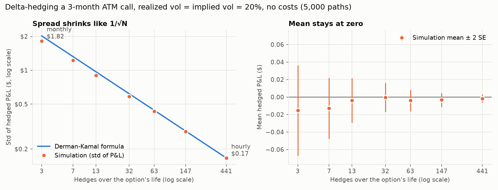
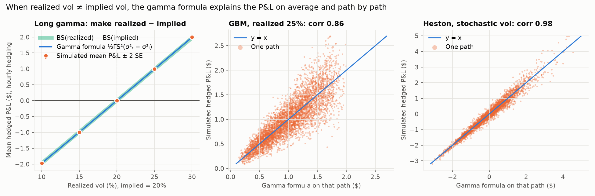

# options-desk

An options desk toolkit in Python: pricing and Greeks, implied vol, volatility surfaces, and
hedging and market-making simulators. Every numerical function is unit-tested against known
answers (textbook values, no-arbitrage identities, finite differences).

## Setup

```powershell
python -m venv .venv
.venv\Scripts\Activate.ps1
pip install -e ".[dev]"
pytest
```

## Pricing (`optdesk.pricing`)

| Module | What it does | Key design choice |
| --- | --- | --- |
| `black_scholes.py` | European call/put price with continuous dividend yield `q` | Forward form `e^(−rT)[F·N(d1) − K·N(d2)]`, consistent with the log-moneyness surface work later; exact zero-vol / expiry limit |
| `greeks.py` | Delta, gamma, vega, theta, rho, vanna, volga, charm, plus per-vol-point and per-day helpers | Closed forms (exact, fast); finite differences only in tests as an independent check |
| `implied_vol.py` | Implied vol from prices, vectorized over a chain | Newton from the Manaster-Koehler inflection point, Brent fallback where vega is tiny, inverts the OTM side via parity, NaN outside no-arbitrage bounds |
| `binomial.py` | CRR tree for American and European options | Recombining `u·d = 1` grid; converges to Black-Scholes at O(1/N) |

```python
from optdesk.pricing.black_scholes import bs_price
from optdesk.pricing.greeks import delta, vega_per_vol_point
from optdesk.pricing.implied_vol import implied_vol
from optdesk.pricing.binomial import binomial_price

px = bs_price(S=100, K=105, T=0.5, r=0.04, sigma=0.22, q=0.01, call=True)
implied_vol(px, S=100, K=105, T=0.5, r=0.04, q=0.01)  # -> 0.22
(
    delta(S=100, K=105, T=0.5, r=0.04, sigma=0.22, q=0.01),
    vega_per_vol_point(S=100, K=105, T=0.5, r=0.04, sigma=0.22),
)
binomial_price(S=100, K=105, T=0.5, r=0.04, sigma=0.22, call=False, american=True)
```

How it's tested: Hull and Haug textbook values; put-call parity, price bounds and Greek parity
identities with Hypothesis (hundreds of random inputs); every Greek against a finite
difference; the Black-Scholes PDE; implied-vol round trips on both solver paths; binomial
convergence to Black-Scholes, American ≥ European, and no early exercise of calls without
dividends.

Conventions: `T` in years (ACT/365); `r`, `q` continuously compounded; vega per 1.00 vol,
theta per year. Interview prep for this module: [`docs/STUDY_NOTES.md`](docs/STUDY_NOTES.md).

## Market data (`optdesk.data`)

| Module | What it does | Key design choice |
| --- | --- | --- |
| `fetch.py` | Downloads full option chains and Treasury yields with yfinance | The only network code; stores raw quotes in one long table so cleaning can be re-run |
| `rates.py` | Converts T-bill/note quotes to continuous zero rates; interpolated `RateCurve` | Linear in `T`, flat beyond the ends |
| `clean.py` | Drops zero-bid, crossed, wide and stale quotes; mid, `T`, forward, OTM only, IV, `k = ln(K/F)` | Forward from put-call parity (median of the 5 nearest strikes), so no dividend or borrow assumption |
| `store.py` | Daily Parquet snapshots at `data/snapshots/{TICKER}/{YYYY-MM-DD}.parquet` | Raw chain plus rate curve in one file, so any day can be re-cleaned exactly |

```powershell
python -m optdesk.data.fetch SPY --max-expiries 6   # fetch, save today's snapshot, print summary
```

```python
from optdesk.data.store import load_snapshot
from optdesk.data.clean import clean_chain

chain, curve = load_snapshot("SPY", "2026-10-19")  # any day you have fetched
clean = clean_chain(chain, curve)  # one OTM quote per strike: forward, T, k, iv, ...
```

How it's tested, fully offline: a fake `yf.Ticker` serves a saved SPY chain and real network
connections are blocked. The chain is synthetic, generated from Black-Scholes with a known
forward, rate and volatility smile, so the cleaner must recover the true forward (to 1e-10)
and true vol of every contract (to 1e-8). It also contains planted bad quotes that must be
flagged. Plus: hand-computed T-bill and bond-yield conversions, year fractions across a
daylight-saving change, a Hypothesis test that parity recovers `S·e^((r−q)T)`, robustness to
a bad quote, and exact Parquet round trips.

## Volatility surface (`optdesk.surface`)

| Module | What it does | Key design choice |
| --- | --- | --- |
| `svi.py` | Raw SVI smile per expiry; robust fit; `fit_chain` fits every expiry of a cleaned chain | Vega-weighted vol residuals; grid over `(m, σ)` with exact linear solves for the other three parameters, then bounded least squares (avoids local minima) |
| `arbitrage.py` | Butterfly check (Gatheral's `g(k) ≥ 0`, Lee's wing bound) and calendar check (`w` non-decreasing in `T` at fixed `k`) | Reports *where* and *how badly* a surface fails, on a grid well beyond the quotes |
| `plot.py` | Plotly 3D surface and per-expiry smile panels; `python -m optdesk.surface.plot` | Surface in ATM standard deviations so every expiry is comparable; nothing drawn beyond the quoted strikes |
| `synthetic.py` | SPY-like American option chain from a known, arbitrage-free SSVI surface | An answer key for the fit: noise, penny ticks and early exercise, through the real cleaner |

**American exercise.** SPY options are American, so their prices include an early-exercise
premium that biases Black-Scholes vols up (~0.6 vol points on a 1-year near-the-money put) and
the parity forward down (~38bp at 1 year). `clean_chain(..., american=True)` strips the
premium on a CRR tree, iterating with the forward, so the surface is fitted to
European-equivalent vols. The command-line tools default to American; pass `--european` for
index options such as SPX.

```powershell
python -m optdesk.surface.plot                                # synthetic market -> data/plots/*.html
python -m optdesk.surface.plot --ticker SPY --date 2026-10-19 # a saved snapshot
```

```python
from optdesk.data.clean import clean_chain
from optdesk.surface.arbitrage import check_surface
from optdesk.surface.plot import smile_figure, surface_figure
from optdesk.surface.svi import fit_chain
from optdesk.surface.synthetic import synthetic_chain

market = synthetic_chain()  # or: chain, curve = load_snapshot("SPY", "2026-10-19")
clean = clean_chain(market.raw, market.curve, american=True)
fits = check_surface(fit_chain(clean))  # a, b, rho, m, sigma, rmse + arbitrage flags per expiry
surface_figure(fits, clean).show()
```

How it's tested: exact recovery of known SVI parameters (to ~1e-8) for equity, FX and
commodity-shaped smiles and through the full clean-and-fit pipeline; with realistic noise and
American pricing, fitted smiles within 0.1 vol points of the truth on every expiry, across
several noise seeds; SVI derivatives against finite differences; Gatheral's density formula
against Breeden-Litzenberger finite differences of Black-Scholes prices; Axel Vogt's slice
flagged for butterfly arbitrage in the right `k` range; hand-built crossing slices flagged
where they cross; the synthetic SSVI surface passing both checks; de-Americanizing recovering
the true forward (0.5bp) and vols, and skipping it showing the known bias; early-exercise
premium of zero where theory says so (Merton's call, puts at zero rates) and matching a
4,000-step reference elsewhere.

## Hedging simulator (`optdesk.sim`)

| Module | What it does | Key design choice |
| --- | --- | --- |
| `paths.py` | GBM paths (exact) and Heston stochastic-vol paths | GBM stepped with its exact solution (no discretization error); Heston by full-truncation Euler, the least-biased of the simple fixes for negative variance |
| `hedging.py` | Buy or sell an option, delta-hedge it at the implied vol along every path, with proportional transaction costs; the gamma-P&L formula; the Derman-Kamal hedging-error estimate | Simulate once, hedge the *same* paths at every frequency, so differences come from hedging and not from luck; P&L in today's money |
| `plot.py` | The 5,000-path study and its charts; `python -m optdesk.sim.plot` | Static PNGs (matplotlib) for the README and notes; the interactive version is for the app (M5) |

A 3-month ATM call bought at 20% implied vol and delta-hedged on 5,000 paths, from monthly
(3 hedges) to hourly (441):



When realized vol is 20%, the mean P&L is zero at every frequency and the spread falls like
`1/√N` (log-log slope −0.48), on top of the Derman-Kamal formula: $1.82 monthly, $0.17 hourly.
When realized vol differs, the average P&L matches the gamma formula `∫ ½ΓS²(σ²_realized −
σ²_implied) dt` and the Black-Scholes value gap: +$0.99 for 25% realized, −$0.99 for 15%.



More charts: [P&L histograms](docs/images/hedge_pnl_histograms.png),
[transaction costs](docs/images/hedge_costs.png).

```powershell
python -m optdesk.sim.plot     # runs the study, prints the tables, writes docs/images/*.png
```

```python
from optdesk.sim.hedging import delta_hedge, gamma_pnl
from optdesk.sim.paths import gbm_paths

paths = gbm_paths(S0=100, mu=0.04 - 0.013, sigma=0.25, T=0.25, n_steps=441, n_paths=5000, rng=1)
res = delta_hedge(paths, K=100, r=0.04, hedge_vol=0.20, q=0.013, rebalance_every=7, cost=0.0005)
res.pnl.mean(), res.pnl.std(), res.costs.mean()
gamma_pnl(paths, K=100, r=0.04, hedge_vol=0.20, q=0.013).mean()  # what the gamma formula predicts
```

How it's tested: GBM moments, normality and the martingale property; GBM giving the same
distribution on any grid; the Heston variance mean-reverting as `θ + (v0 − θ)e^(−κt)`, the
martingale property, correlation ρ between shocks, no negative variance when Feller fails,
and reduction to GBM with no vol of vol. Hedging: zero mean P&L at fair vol (also under a 15%
real-world drift), std slope −½ and within 10% of Derman-Kamal, the right sign when realized
≠ implied, mean P&L equal to the gamma formula and to `BS(realized) − BS(implied)` within 4
standard errors, the formula tracking P&L path by path under GBM and Heston, hedged
put-call parity (exact to 1e-10 without dividends), short = −long exactly, and costs that are
non-negative, grow with frequency and lower P&L by exactly their amount.
