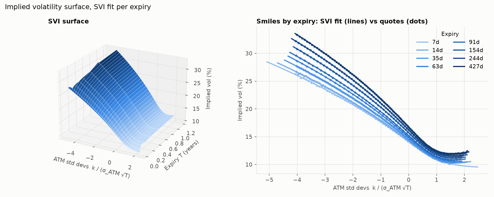
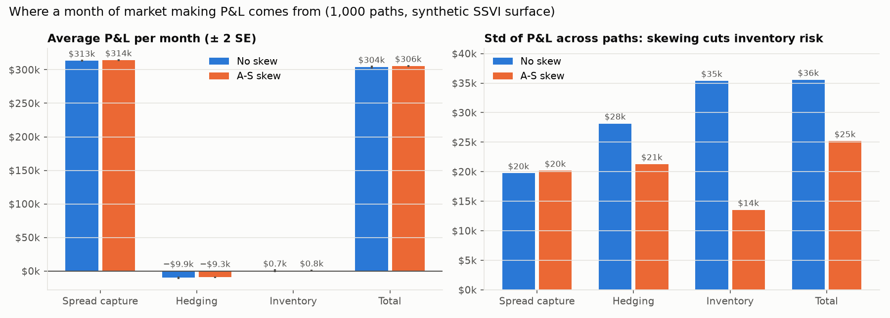
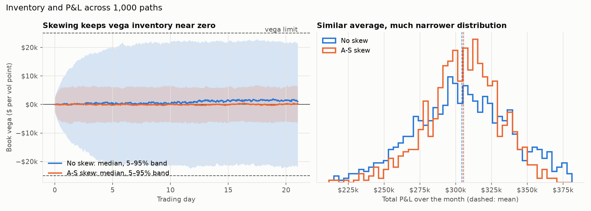

# options-desk

A Python toolkit that does the core work of an equity options desk, from raw quotes to a
risk-managed book. It prices European and American options and their Greeks, downloads and
cleans SPY option chains, backs out implied vols and fits an arbitrage-checked SVI
volatility surface. On that surface it runs two simulators: one delta-hedges an option on
thousands of price paths, the other makes markets in a book of SPY options with
Avellaneda-Stoikov inventory skew, risk limits and a P&L split into spread capture, hedging
and inventory. A Streamlit dashboard puts all of it behind sliders. Every numerical function
is unit-tested against a known answer (textbook values, no-arbitrage identities, finite
differences, theoretical moments): 437 tests, all offline.

> **Status:** every result below is on a **synthetic SPY market**: a known, arbitrage-free
> SSVI surface run through the real cleaning and fitting pipeline, so each number can be
> checked against the truth. The first live SPY snapshot is scheduled for Monday 2026-10-19,
> after which the surface and market-maker results will be rerun on real quotes.

## Results

### 1. Volatility surface



- **Fit quality:** SVI fitted per expiry to 649 cleaned quotes across 8 expiries (7 days to
  14 months). RMSE is **0.01–0.04 vol points** per expiry. With bid-ask noise and American
  early exercise in the prices, every fitted smile stays within **0.1 vol points** of the true
  surface.
- **No arbitrage:** every slice passes the butterfly check (Gatheral's `g(k) ≥ 0`, minimum
  0.25) and the calendar check (total variance rising with expiry at every strike).
- **American exercise matters:** SPY options are American. Treating them as European biases a
  1-year near-the-money put's implied vol up by **~0.6 vol points** and the parity forward
  down by **~38bp**. The cleaner strips the early-exercise premium on a binomial tree first,
  which recovers the true forward to **0.5bp**.

### 2. Delta hedging


A 3-month at-the-money call ($4.31 premium) bought at 20% implied vol and delta-hedged on the
same 5,000 paths at seven frequencies:

- **Discrete hedging leaves risk, and it falls like 1/√N.** P&L std is **$1.82** hedging
  monthly (42% of the premium) and **$0.17** hourly (4%). The log-log slope is **−0.48**
  (theory −0.5), and every point sits within 10% of the Derman-Kamal formula ($2.02 → $0.17).
  The mean stays at zero at every frequency (all within 1 standard error).
- **Hedging P&L is a bet on realized vs implied vol.** Hedged hourly at 20%, the average P&L
  is **+$0.99** if the stock realizes 25% and **−$0.99** if it realizes 15%. That matches the
  gamma formula `∫ ½ΓS²(σ²_realized − σ²_implied) dt` (+$0.991 / −$0.993) and the
  Black-Scholes value gap. Path by path, the formula and the P&L have a correlation of
  0.86–0.99.
- **It holds under stochastic vol.** On Heston paths (vol of vol 50%, spot-vol correlation
  −0.7) the mean P&L is −$0.163 against −$0.164 from the formula, with a path-by-path
  correlation of **0.98**.
- **Costs make hedging frequency a trade-off.** At a 5bp half-spread, going from daily to
  hourly cuts the std from $0.43 to $0.20 but more than doubles the cost, from $0.15 to
  **$0.36 per option (8% of premium)**.


More: [P&L histograms](docs/images/hedge_pnl_histograms.png),
[transaction costs](docs/images/hedge_costs.png).

### 3. Market making



One month of making markets in 12 SPY options (2-, 3- and 6-month expiries), 1,000 paths,
with implied vols moving 10 points a year (correlated −0.7 with spot). The two desks see the
same market and the same customers:

| $ per month | No skew | A-S skew |
| --- | --- | --- |
| Spread capture | 313,491 | 314,186 |
| Hedging | −9,885 | −9,319 |
| Inventory | +669 | +766 |
| **Total P&L (mean ± SE)** | **304,275 ± 1,124** | **305,633 ± 796** |
| **Total P&L std** | **35,544** | **25,162** |
| Inventory P&L std | 35,371 | 13,510 |
| Average \|book vega\| ($ per vol point) | 10,367 | 2,994 |
| Steps with a quote pulled by a risk limit | 4.5% | 0.6% |

- **The money is the spread.** Spread capture is ~103% of P&L (about $430 a fill over ~730
  fills); hedging costs take ~3% back.
- **Skewing quotes by inventory cuts risk by 29% at no cost to the mean.** Inventory risk falls
  by almost two thirds ($35k → $14k) because book vega mean-reverts instead of random-walking
  into the limit. The mean is unchanged within one standard error ($305.6k vs $304.3k), and
  the risk limits almost stop binding.
- **There is a frontier.** A little risk aversion slightly *raises* the mean; past
  `γ ≈ 5×10⁻⁵` the risk stops falling (~$24k) and spread capture drops ($301k at
  `γ = 2×10⁻⁴`). What's left is gamma and smile risk that a vega-only skew can't see.



More: [one simulated month](docs/images/mm_path.png),
[quote skew and the risk-aversion frontier](docs/images/mm_frontier.png).

## Install and run

Needs Python 3.11 or newer. On Windows (PowerShell):

```powershell
git clone https://github.com/arjun-chowdhry/options-desk.git
cd options-desk
python -m venv .venv                 # a private Python environment for this project
.venv\Scripts\Activate.ps1           # macOS/Linux: source .venv/bin/activate
pip install -e ".[dev]"              # the package plus pytest and ruff
pytest                               # run the test suite (offline, a few minutes)
```

Then:

```powershell
streamlit run src/optdesk/app/main.py                     # the dashboard, in your browser
python -m optdesk.surface.plot --png docs/images/surface.png  # fit the surface, write the plots
python -m optdesk.sim.plot                                # hedging study: tables + charts
python -m optdesk.sim.mm_plot                             # market-making study: tables + charts
python -m optdesk.data.fetch SPY --max-expiries 6         # save today's SPY chain (market hours)
```

Every study is seeded, so these commands reproduce the numbers above exactly. After fetching a
snapshot, add `--ticker SPY --date YYYY-MM-DD` to the surface and market-maker commands, or
pick the snapshot in the dashboard's sidebar.

## Assumptions and limitations

**Pricing**
- Black-Scholes with a continuous dividend yield and constant rates. SPY's dividends are
  really discrete and quarterly; a continuous yield backed out of the put-call parity
  forward is a close but not exact stand-in.
- American options are priced on a CRR binomial tree with that same continuous yield, so the
  early-exercise premium around ex-dividend dates is approximate.

**Data**
- yfinance quotes are free, delayed about 15 minutes and come without quote timestamps, so the
  cleaner can only filter stale quotes by last-trade time. It's fine for end-of-day
  surfaces but not for intraday trading.
- The live-fetch path is tested only against a mocked yfinance; the first real run is pending
  (2026-10-19).

**Volatility surface**
- Raw SVI is fitted one expiry at a time. Arbitrage is *checked and reported*, not
  *enforced*, so a noisy live chain can produce a flagged slice that needs refitting or
  dropping. A joint SSVI fit would rule out calendar arbitrage by construction.
- Between expiries, total variance is interpolated linearly in `T`, and SVI's wings are
  extrapolated beyond the quoted strikes with no data behind them.

**Hedging simulator**
- Costs are a proportional half-spread; no market impact, financing spread or borrow cost.
- Time is trading time: no overnight gaps or jumps. Real stocks gap at the open and on news,
  which makes discrete hedging error fatter-tailed than shown here.

**Market maker**
- **No adverse selection.** Customers arrive at random (Poisson) and are uninformed: their
  trades don't predict the next move. Real flow is partly informed, so the ~$305k a month of
  spread capture is an upper bound, not an estimate of a real desk's revenue.
- The desk's theo is the *true* surface. A real desk's theo has fitting error, and quoting off
  a wrong theo leaks edge to customers.
- The whole surface moves in parallel by a single vol factor, with fixed smile shape. Skew
  and term-structure moves aren't simulated, which is why a vega-only skew looks so effective.
- Fills are in fixed sizes at the quoted price, with no competing market makers and no
  queue position.

**Results**
- All published numbers come from the synthetic SSVI surface (see Status above). The
  synthetic chain is built to look like SPY, but it is not SPY.

## Project layout

```
src/optdesk/
  pricing/  black_scholes.py, greeks.py, implied_vol.py, binomial.py, portfolio.py
  data/     fetch.py, clean.py, rates.py, store.py
  surface/  svi.py, arbitrage.py, plot.py, synthetic.py, source.py, market.py
  sim/      paths.py, hedging.py, plot.py, market_maker.py, mm_plot.py, lab.py
  app/      main.py, views/, charts.py
tests/      mirrors src/optdesk/; fixtures/ holds a saved chain for offline tests
docs/       STUDY_NOTES.md (theory, formulas, interview questions), images/
```

The reasoning behind each model choice is in the module docstrings and in
[`docs/STUDY_NOTES.md`](docs/STUDY_NOTES.md), which also has interview questions for every
section and a whole-project set at the end.

---

## Module reference

### Pricing (`optdesk.pricing`)

| Module | What it does | Key design choice |
| --- | --- | --- |
| `black_scholes.py` | European call/put price with continuous dividend yield `q` | Forward form `e^(−rT)[F·N(d1) − K·N(d2)]`, consistent with the log-moneyness surface work later; exact zero-vol / expiry limit |
| `greeks.py` | Delta, gamma, vega, theta, rho, vanna, volga, charm, plus per-vol-point and per-day helpers | Closed forms (exact, fast); finite differences only in tests as an independent check |
| `implied_vol.py` | Implied vol from prices, vectorized over a chain | Newton from the Manaster-Koehler inflection point, Brent fallback where vega is tiny, inverts the OTM side via parity, NaN outside no-arbitrage bounds |
| `binomial.py` | CRR tree for American and European options | Recombining `u·d = 1` grid; converges to Black-Scholes at O(1/N) |

```python
from optdesk.pricing.black_scholes import bs_price
from optdesk.pricing.greeks import delta, vega_per_vol_point
from optdesk.pricing.implied_vol import implied_vol
from optdesk.pricing.binomial import binomial_price

px = bs_price(S=100, K=105, T=0.5, r=0.04, sigma=0.22, q=0.01, call=True)
implied_vol(px, S=100, K=105, T=0.5, r=0.04, q=0.01)  # -> 0.22
(
    delta(S=100, K=105, T=0.5, r=0.04, sigma=0.22, q=0.01),
    vega_per_vol_point(S=100, K=105, T=0.5, r=0.04, sigma=0.22),
)
binomial_price(S=100, K=105, T=0.5, r=0.04, sigma=0.22, call=False, american=True)
```

How it's tested: Hull and Haug textbook values; put-call parity, price bounds and Greek parity
identities with Hypothesis (hundreds of random inputs); every Greek against a finite
difference; the Black-Scholes PDE; implied-vol round trips on both solver paths; binomial
convergence to Black-Scholes, American ≥ European, and no early exercise of calls without
dividends.

Conventions: `T` in years (ACT/365); `r`, `q` continuously compounded; vega per 1.00 vol,
theta per year.

### Market data (`optdesk.data`)

| Module | What it does | Key design choice |
| --- | --- | --- |
| `fetch.py` | Downloads full option chains and Treasury yields with yfinance | The only network code; stores raw quotes in one long table so cleaning can be re-run |
| `rates.py` | Converts T-bill/note quotes to continuous zero rates; interpolated `RateCurve` | Linear in `T`, flat beyond the ends |
| `clean.py` | Drops zero-bid, crossed, wide and stale quotes; mid, `T`, forward, OTM only, IV, `k = ln(K/F)` | Forward from put-call parity (median of the 5 nearest strikes), so no dividend or borrow assumption |
| `store.py` | Daily Parquet snapshots at `data/snapshots/{TICKER}/{YYYY-MM-DD}.parquet` | Raw chain plus rate curve in one file, so any day can be re-cleaned exactly |

```python
from optdesk.data.store import load_snapshot
from optdesk.data.clean import clean_chain

chain, curve = load_snapshot("SPY", "2026-10-19")  # any day you have fetched
clean = clean_chain(chain, curve)  # one OTM quote per strike: forward, T, k, iv, ...
```

How it's tested, fully offline: a fake `yf.Ticker` serves a saved SPY chain and real network
connections are blocked. The chain is synthetic, generated from Black-Scholes with a known
forward, rate and volatility smile, so the cleaner must recover the true forward (to 1e-10)
and true vol of every contract (to 1e-8). It also contains planted bad quotes that must be
flagged. Plus: hand-computed T-bill and bond-yield conversions, year fractions across a
daylight-saving change, a Hypothesis test that parity recovers `S·e^((r−q)T)`, robustness to
a bad quote, and exact Parquet round trips.

### Volatility surface (`optdesk.surface`)

| Module | What it does | Key design choice |
| --- | --- | --- |
| `svi.py` | Raw SVI smile per expiry; robust fit; `fit_chain` fits every expiry of a cleaned chain | Vega-weighted vol residuals; grid over `(m, σ)` with exact linear solves for the other three parameters, then bounded least squares (avoids local minima) |
| `arbitrage.py` | Butterfly check (Gatheral's `g(k) ≥ 0`, Lee's wing bound) and calendar check (`w` non-decreasing in `T` at fixed `k`) | Reports *where* and *how badly* a surface fails, on a grid well beyond the quotes |
| `plot.py` | Plotly 3D surface and per-expiry smile panels, plus a static PNG for this README | Surface in ATM standard deviations so every expiry is comparable; nothing drawn beyond the quoted strikes |
| `synthetic.py` | SPY-like American option chain from a known, arbitrage-free SSVI surface | An answer key for the fit: noise, penny ticks and early exercise, through the real cleaner |

`clean_chain(..., american=True)` strips the early-exercise premium on a CRR tree, iterating
with the forward, so the surface is fitted to European-equivalent vols. The command-line tools
default to American; pass `--european` for index options such as SPX.

```python
from optdesk.data.clean import clean_chain
from optdesk.surface.arbitrage import check_surface
from optdesk.surface.plot import smile_figure, surface_figure
from optdesk.surface.svi import fit_chain
from optdesk.surface.synthetic import synthetic_chain

market = synthetic_chain()  # or: chain, curve = load_snapshot("SPY", "2026-10-19")
clean = clean_chain(market.raw, market.curve, american=True)
fits = check_surface(fit_chain(clean))  # a, b, rho, m, sigma, rmse + arbitrage flags per expiry
surface_figure(fits, clean).show()
```

How it's tested: exact recovery of known SVI parameters (to ~1e-8) for equity, FX and
commodity-shaped smiles and through the full clean-and-fit pipeline; with realistic noise and
American pricing, fitted smiles within 0.1 vol points of the truth on every expiry, across
several noise seeds; SVI derivatives against finite differences; Gatheral's density formula
against Breeden-Litzenberger finite differences of Black-Scholes prices; Axel Vogt's slice
flagged for butterfly arbitrage in the right `k` range; hand-built crossing slices flagged
where they cross; the synthetic SSVI surface passing both checks; de-Americanizing recovering
the true forward (0.5bp) and vols, and skipping it showing the known bias; early-exercise
premium of zero where theory says so (Merton's call, puts at zero rates) and matching a
4,000-step reference elsewhere; the README image plotting the same vols as the interactive
surface.

### Hedging simulator (`optdesk.sim`)

| Module | What it does | Key design choice |
| --- | --- | --- |
| `paths.py` | GBM paths (exact) and Heston stochastic-vol paths | GBM stepped with its exact solution (no discretization error); Heston by full-truncation Euler, the least-biased of the simple fixes for negative variance |
| `hedging.py` | Buy or sell an option, delta-hedge it at the implied vol along every path, with proportional transaction costs; the gamma-P&L formula; the Derman-Kamal hedging-error estimate | Simulate once, hedge the *same* paths at every frequency, so differences come from hedging and not from luck; P&L in today's money |
| `plot.py` | The 5,000-path study and its charts; `python -m optdesk.sim.plot` | Static PNGs (matplotlib) for the README and notes; the interactive version is in the app |

```python
from optdesk.sim.hedging import delta_hedge, gamma_pnl
from optdesk.sim.paths import gbm_paths

paths = gbm_paths(S0=100, mu=0.04 - 0.013, sigma=0.25, T=0.25, n_steps=441, n_paths=5000, rng=1)
res = delta_hedge(paths, K=100, r=0.04, hedge_vol=0.20, q=0.013, rebalance_every=7, cost=0.0005)
res.pnl.mean(), res.pnl.std(), res.costs.mean()
gamma_pnl(paths, K=100, r=0.04, hedge_vol=0.20, q=0.013).mean()  # what the gamma formula predicts
```

How it's tested: GBM moments, normality and the martingale property; GBM giving the same
distribution on any grid; the Heston variance mean-reverting as `θ + (v0 − θ)e^(−κt)`, the
martingale property, correlation ρ between shocks, no negative variance when Feller fails,
and reduction to GBM with no vol of vol. Hedging: zero mean P&L at fair vol (also under a 15%
real-world drift), std slope −½ and within 10% of Derman-Kamal, the right sign when realized
≠ implied, mean P&L equal to the gamma formula and to `BS(realized) − BS(implied)` within 4
standard errors, the formula tracking P&L path by path under GBM and Heston, hedged
put-call parity (exact to 1e-10 without dividends), short = −long exactly, and costs that are
non-negative, grow with frequency and lower P&L by exactly their amount.

### Market-making simulator (`optdesk.sim.market_maker`)

| Module | What it does | Key design choice |
| --- | --- | --- |
| `surface/source.py` | One `VolSurface` interface (`implied_vol(k, T)`) with three sources: the synthetic SSVI surface, any SVI fit table (live snapshots), and a flat surface | The simulator never knows where vols come from; fitted slices interpolate total variance linearly in T, which can't create calendar arbitrage |
| `market_maker.py` | Quotes bid/ask around theo on a book of SPY options, takes Poisson customer flow, tracks book delta, gamma and vega, delta-hedges every step, skews quotes by inventory, enforces vega and gamma limits, and splits P&L into spread capture, hedging and inventory | Avellaneda-Stoikov in *vol* space: after delta hedging the inventory risk is vega, so every quote shifts by `γ·σ_v²·H·(book vega)` vol points |
| `mm_plot.py` | The 1,000-path study (skew vs no skew on the same market and the same customers, plus a risk-aversion sweep); `python -m optdesk.sim.mm_plot` | Common random numbers, so differences come from the quoting rule, not luck |

```python
from optdesk.sim.market_maker import Contract, QuoteParams, run_market_maker, simulate_market
from optdesk.surface.source import synthetic_surface

# spot 580, r 4%, q 1.3%, 15% vol, 1 month of 546 steps, 200 paths
market = simulate_market(580, 0.04, 0.013, 0.15, 1 / 12, 546, 200, rng=1, vol_of_vol=0.10)
book = [Contract(K=555, T=0.25, call=False), Contract(K=585, T=0.25, call=True)]
res = run_market_maker(market, book, synthetic_surface(), QuoteParams(vega_limit=25_000), rng=2)
res.spread.mean(), res.hedging.mean(), res.inventory.mean(), res.total.std()
```

How it's tested: quotes symmetric at zero inventory; the skew moving both quotes against the
inventory by exactly `γσ_v²HV`; the spread equal to the textbook A-S formula, tending to `2/k`
as `γ → 0` and rising with vol of vol and risk aversion; Poisson fill counts matching their
expectation (mean and variance); the three P&L buckets adding to the mark-to-market P&L to
1e-9; zero inventory P&L with no vol moves; hedging P&L equal to minus costs on average when
realized = implied; both delta methods agreeing on a flat surface; vega and gamma limits
binding; reproducibility from seeds; skewing cutting the spread of ending vega by over half;
and a fitted SVI surface reproducing the analytic one's results.

### Dashboard (`optdesk.app`)

`streamlit run src/optdesk/app/main.py` opens a browser tab with four tabs, all driven by one
market chosen in the sidebar:

| Tab | What you can do | Built on |
| --- | --- | --- |
| **Surface** | Rotate the 3D SVI surface, compare each expiry's smile with the quotes, read the fit RMSE and the butterfly / calendar arbitrage flags | `surface/svi.py`, `arbitrage.py`, `plot.py` |
| **Hedging simulator** | Buy or sell a call or put, pick its strike and expiry, the implied vol (the surface's vol for that strike, or your own) and the realized vol (GBM) or Heston parameters, hedge frequency, costs and path count, then see the P&L distribution, the `1/√N` law against Derman-Kamal, and P&L path by path against the gamma formula | `sim/lab.py` → `paths.py`, `hedging.py` |
| **Market maker** | Set risk aversion, fill model, vol of vol, spot-vol correlation and vega/gamma limits; the skewed and unskewed desks run on the same market and customers, with P&L attribution, book vega bands, P&L distributions and the quote-skew curve | `sim/lab.py` → `market_maker.py` |
| **Portfolio Greeks** | Start from a preset book (straddle, risk reversal, calendar, butterfly) and edit it like a spreadsheet; see delta, gamma, vega, theta, rho, vanna and volga per position and in total (desk units), optionally delta-hedged with shares, plus a spot × vol scenario grid by full revaluation and where the Greeks' Taylor estimate breaks down | `pricing/portfolio.py` |

| Module | What it does | Key design choice |
| --- | --- | --- |
| `surface/market.py` | One `MarketData` bundle (spot, r, q, pricing surface, SVI fits, clean quotes) from the synthetic market or any saved snapshot; `available_sources()` lists them | The app only sees a `MarketData`, so live data is a dropdown choice: a new snapshot appears on its own once saved, no code changes. For snapshots `q` is backed out of the parity forward, so theo uses the options' own carry |
| `pricing/portfolio.py` | Book Greeks in desk units ($ per vol point, $ per day, $ delta per 1%), share hedge, scenario grid, Taylor estimate | Scenarios reprice every option (full revaluation, parallel sticky-strike vol shocks) instead of trusting the Greeks for large moves |
| `sim/lab.py` | The hedging and market-making experiments with every parameter exposed, returning chart-ready results | The app holds no math: percentiles, average P&L paths and quote curves are computed and tested here |
| `app/` | `main.py` (sidebar and tabs), `views/` (one file per tab, layout only), `charts.py` (Plotly figures) | The market and every simulation are cached by their inputs, so moving between tabs is instant; simulation controls sit in forms and run when you press **Run simulation** |

Snapshots saved by `python -m optdesk.data.fetch` under `data/snapshots/` show up in the
sidebar's **Data source** list; set `OPTDESK_SNAPSHOT_ROOT` to read them from elsewhere.

How it's tested: the portfolio Greeks equal the closed-form Greeks times size, call minus put
is a forward (delta `e^(−qT)`, zero gamma and vega), finite differences of the scenario grid
recover delta, gamma and vega, and the Taylor error shrinks 8× when the move halves; the
market sources recover spot, rates, the parity-implied dividend yield and the true surface from
a saved snapshot; the labs reproduce the hedging and market-making answer keys (zero mean and
Derman-Kamal std at fair vol, `BS(realized) − BS(implied)` at the wrong vol, buckets summing to
total); and `streamlit.testing.v1.AppTest` runs the real app headless: every tab renders, the
hedging widgets rerun the simulation, the delta-hedge checkbox flattens delta, and a saved
snapshot appears in the dropdown and loads.
